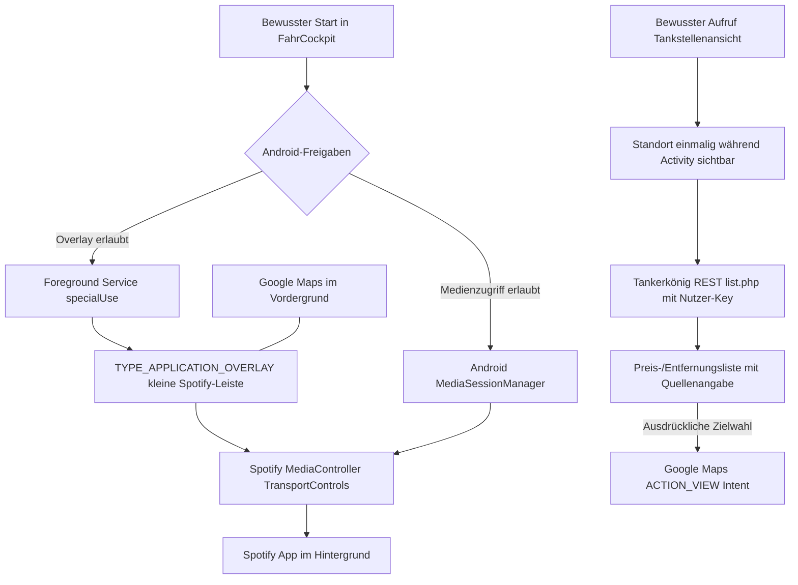

# FahrCockpit · Architekturentscheidung (07.11.2026)

## Ziel und Grenzen

**Zielhardware:** Android-Smartphone mit Google Maps als aktiver Vollbildnavigation
und Spotify als separater Wiedergabe-App. **Kein Android Auto**.
FahrCockpit ist eine eigene native Android-App, nicht eine zusätzliche
Ansicht in der Japan-Reise-PWA.

**Leitprinzip:** FahrCockpit steuert nur das, wofür Android eine dokumentierte
Schnittstelle bereitstellt. Es zeichnet keinen Bildschirm auf, liest keine
Maps-Routen aus und simuliert keine Eingaben in andere Apps.

## Datenfluss

### 1. Native Overlay-Schicht

- `CockpitOverlayService` läuft ausschließlich nach einem expliziten Start
  aus einer sichtbaren `MainActivity`.
- `SYSTEM_ALERT_WINDOW` ist eine Android-Spezialberechtigung, die der Benutzer
  im Systemdialog **selbst** erteilen muss.
- Window type `TYPE_APPLICATION_OVERLAY`, `FLAG_NOT_FOCUSABLE` und
  `FLAG_NOT_TOUCH_MODAL` – Google Maps bleibt unter der kleinen Leiste bedienbar.
- Eine persistente Benachrichtigung bietet **Beenden**; das Overlay besitzt
  zusätzlich ein jederzeit sichtbares X.
- Android 14+ Foreground-Service-Typ `specialUse` mit erklärtem Zweck.
  Android 15+ erlaubt einen beliebigen Hintergrundstart gerade nicht; nur
  bewusster Start aus der Vordergrund-Activity. Kein Boot-Receiver.
- Android kann Overlays auf sensiblen Systemseiten oder bei Ressourcenmangel
  ausblenden; dieses Verhalten darf nie umgangen werden.

### 2. Spotify-Adapter

- Adapter: `MediaSessionManager.getActiveSessions(notificationListener)`
  mit explizit freigeschaltetem `NotificationListenerService`.
- **Nur** Controller mit Paket `com.spotify.music` auswählen.
- `ACTION_PLAY`, `ACTION_PAUSE`, `ACTION_SKIP_TO_NEXT`,
  `ACTION_SKIP_TO_PREVIOUS` und `ACTION_SEEK_TO` jeweils zur Laufzeit prüfen.
- 15-Sekunden-Sprünge nutzen `MediaController.TransportControls.seekTo`;
  Position und Trackdauer werden geklemmt. Wenn das Medium nicht spulbar ist,
  wird die Funktion nicht vorgetäuscht.
- **Kein Spotify OAuth/API-Key** für den ersten Prototyp. Medienzugriff ist
  jedoch eine weitreichende Android-Systemfreigabe und muss erklärt werden.
- Keine Speicherung von Titel, Künstler, Hörverlauf oder Notifications.
- Später optional offizielles Spotify App Remote SDK, falls ein konkreter
  Medienbefehl über die System-Session nicht funktioniert; nur nach Prüfung
  der dann geltenden SDK-Bedingungen.

### 3. Tankstellen / Preise (separates Folgepaket)

- Persönlicher Tankerkönig-Key wird vom Nutzer bei Einrichtung eingegeben,
  niemals in öffentliche Repos, Screenshots oder eine serverseitige Logdatei.
- Schlüssel nur im App-Privatspeicher mit Android Keystore verschlüsselt.
  Ein Android-APK kann einen eingebauten Schlüssel nicht sicher verbergen;
  deshalb kein hartkodierter oder gemeinsam geteilter API-Key.
- `ACCESS_COARSE_LOCATION` / `ACCESS_FINE_LOCATION` erst für dieses Feature;
  **keine** `ACCESS_BACKGROUND_LOCATION`-Berechtigung.
- Nutzer tippt `Tankstellen laden` im Vordergrund: einzelne
  `getCurrentLocation`-Abfrage, anschließend
  `https://creativecommons.tankerkoenig.de/json/list.php`
  mit Standort, Radius <= 25 km, `type=e5|e10|diesel` und
  `sort=price|dist`.
- Reale Preisdaten mit Quelle/Abfragezeit, offen/geschlossen, Luftlinien-
  entfernung und ggf. fehlender Preis kennzeichnen.
- **Kein automatisches Polling**, keine Massendatenabfrage; bei Fehlern
  verständliche Fehlermeldung. Kein Standard-API-Key.
- Öffnet eine ausgewählte Station erst nach ausdrücklichem Tippen über
  Maps-Intent. Eine laufende Maps-Route kann dadurch ersetzt werden; deshalb
  vorher eindeutig darauf hinweisen. **Nicht** behaupten, Stationen lägen
  entlang der laufenden Maps-Route.
- Der Anbieter kann API-Zugang, Preise und Rate Limits ändern; Einsatz
  nur unter seinen aktuellen Nutzungsbedingungen/CC-BY-4.0-Attribution.

### 4. Sicherheits- und Bediengrenzen

- Minimaler, kontrastreicher, verschiebbarer Overlay-Streifen;
  keine vollständige Karte, kein Texteditor während der Fahrt.
- Interaktive Flächen >= 44–48dp, kein Zwang zum Tippen während der Fahrt.
  Einrichtung, Kraftstoffauswahl und Zielwahl im Stand.
- Keine Blitzer.de-Integration oder aktiven Radarwarnungen für den Fahrer:
  in Deutschland nach §23 Abs.1c StVO unzulässig.
- Keine Screensharing-, Accessibility- oder Usage-Stats-Berechtigungen.
- Kein Standort-Tracking, keine Cloud-Synchronisierung, keine Werbung,
  kein Abo und keine Kosten-API für die erste Ausbaustufe.

## Release- und Teststrategie

1. **Jetzt:** Architektur + Minimal-APK im isolierten Draft-PR der
   bestehenden `CobraChris/app-fabrik-template`.
2. CI: Android-Java-17, Android SDK 35, JUnit, Lint und Debug-APK im
   **read-only** Job ohne Signatursecrets.
3. Manuelle Geräte-Abnahme auf dem Samsung (Android 16):
   Overlay-Berechtigung, Notification-Zugriff, Spotify-Song und Podcast,
   `seekTo` unterstützt/nicht unterstützt, Google Maps Hintergrundnutzung,
   Bildschirmrotation, Sperren/Entsperren, Stoppen und Wiederstart.
4. Stabilität: keine Overlay-Duplikate, X und Benachrichtigungs-Stopp
   funktionieren, Maps bleibt außerhalb der schmalen Leiste interaktiv.
5. **Erst nach Android-Abnahme:** Eigene FahrCockpit-Signing-Identity und
   signierte Beta über den bestehenden App-Fabrik-Prozess freigeben.
   Die Sanftwecker-Schlüssel dürfen nicht wiederverwendet werden.
6. Tankerkönig-Key und Standortberechtigung werden erst in einer getrennten
   freiwilligen Folgefunktion aktiviert. Kein Datenzugriff, solange ungenutzt.

## Fehlermodi und Rückfallstrategien

| Störung | Erwartetes Verhalten |
| --- | --- |
| Kein Overlay-Recht | Start verweigert und Systemfreigabe angeboten |
| Kein Medienzugriff | Spotify-Steuerung meldet fehlenden Zugriff |
| Spotify nicht aktiv | Keine andere Musik-App unbemerkt steuern |
| Spulen nicht unterstützt | Klare Meldung; kein falscher Fortschritt |
| Google Maps im Hintergrund | Weiterhin standardmäßige Google-Maps-Navigation |
| App/Service beendet | Kleine Leiste wird entfernt, keine Autoneustarts |
| Tankerkönig nicht verfügbar | Keine erfundenen Preise; später erneut versuchen |
| API-Key fehlt | Keine Abfrage und keine kostenpflichtige Fallback-API |
| Maps überlagert sensible Ansicht | Android darf Overlay ausblenden |

## Technische Quellen

- Android `TYPE_APPLICATION_OVERLAY`: https://developer.android.com/reference/android/view/WindowManager.LayoutParams
- Android `MediaSessionManager`: https://developer.android.com/reference/android/media/session/MediaSessionManager
- Android `MediaController.TransportControls`: https://developer.android.com/reference/android/media/session/MediaController.TransportControls
- Android FGS `specialUse`: https://developer.android.com/develop/background-work/services/fgs/service-types
- Tankerkönig API/AGB: https://creativecommons.tankerkoenig.de/
- ADAC Blitzer-App-Rechtslage: https://www.adac.de/verkehr/recht/verkehrsvorschriften-deutschland/radarwarner/
